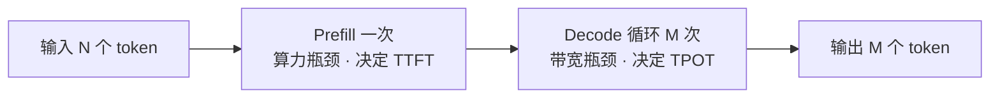

> 这是呈现机制的样例，用来固定每日页版式。它不是某一次打卡，不要写入 `progress.md`。
> 内容提炼自已核实条目 [Prefill vs Decode 两阶段](../entries/B-inference/prefill-vs-decode.md)。

## 今日学习卡片

大模型推理分成两个特性相反的阶段。Prefill 把整段输入一次并行算完，瓶颈是 GPU 算力；Decode 之后每步只吐一个 token，瓶颈是显存带宽。输入便宜、输出更贵，根子在这里。

| | Prefill | Decode |
| --- | --- | --- |
| 怎么算 | 整段输入并行，只做一次 | 每步 1 个新 token，串行循环 |
| 瓶颈 | GPU 算力（compute-bound） | 显存带宽（memory-bound） |
| 用户感受到的 | 首 token 延迟 TTFT | 每个后续 token 的时间 TPOT |

端到端延迟 ≈ TTFT + TPOT × 输出 token 数。输入长、输出短的请求偏 Prefill；输出长的请求偏 Decode，会把 GPU 占更久。

**对我的意义**

- 报价要分开看输入和输出：输出更贵，是因为 Decode 串行占着卡，不是随意加价。
- 成本测算先判断请求是 Prefill 型还是 Decode 型，长输出场景可以单独定价。
- Decode 重的负载更吃带宽，采购时这是 H100 还是 H200 的一个判断依据。PD 分离是把两阶段拆开优化的降本方向。

## 今天的回顾

- 样例没有点名回顾项。正式每日页在这里写当天点名、已经核实的回顾。没点名的不出现在本页。

## Quiz

### 1

Prefill 阶段的瓶颈资源是什么？

- [ ] 显存带宽
- [x] GPU 算力（FLOPS）
- [ ] 磁盘 IO

> 解析：Prefill 把全部输入 token 一次性并行计算，形成大矩阵乘，算术强度高，算力是瓶颈。

### 2

Decode 为什么是访存密集？

- [x] 每步只算 1 个新 token，却要反复读取全部权重和 KV Cache
- [ ] 因为它并行处理了全部输入
- [ ] 因为输出 token 数量一定多于输入

> 解析：算得少、搬得多，所以卡在 HBM 带宽，而不是卡在算力。

### 3

端到端延迟主要由哪两项构成？

- [ ] 排队时间 + 网络往返
- [x] TTFT（Prefill 主导）+ TPOT × 输出 token 数（Decode 主导）
- [ ] 只由首 token 延迟决定

> 解析：首 token 看 Prefill，之后每个输出 token 看 Decode。输出越长，Decode 占比越高。

### 4

「输出 token 更贵」是厂商随意加价。

- [ ] 对
- [x] 错

> 解析：Decode 串行、占用 GPU 的时间更长，单位成本本来就更高。

### 5

加大 batch，对 Prefill 和 Decode 的收益一样。

- [ ] 对
- [x] 错

> 解析：Decode 受带宽限制，组批能摊薄权重搬运，收益尤其明显。Prefill 已经吃紧算力，组批收益不同。
